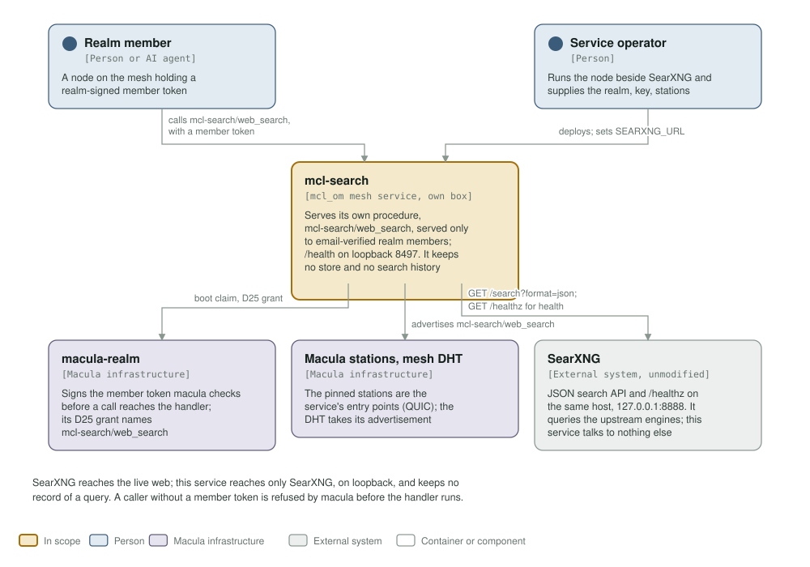
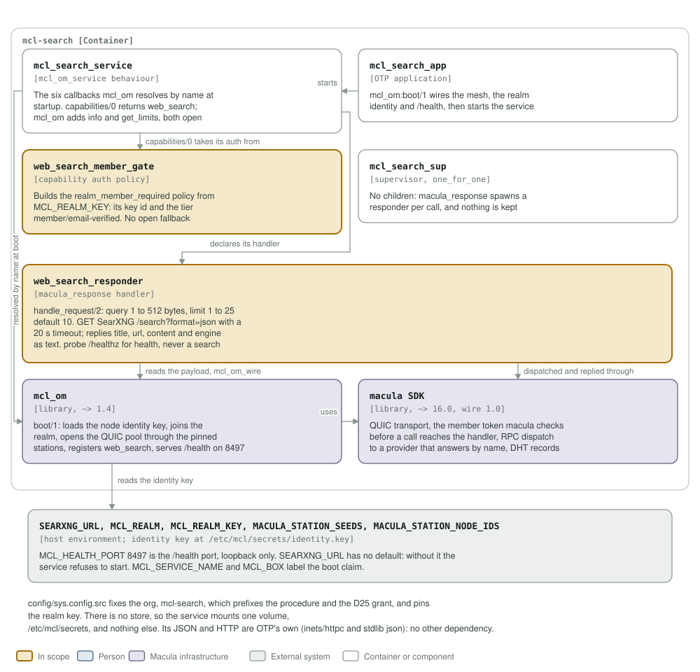

# mcl-search architecture: C4 model

*This exists so a reader can see what mcl-search talks to, and what it is made
of, without reading it.*

**Status: one procedure of its own, release 0.1.0.** The service boots, joins the mesh,
advertises `mcl-search/web_search` under the member policy, and answers
`/health` on `127.0.0.1:8497`. It keeps no store and no record of a query.
SearXNG must be reachable at `SEARXNG_URL` or the service refuses to start.

## Level 1: system context

| Element | Kind | Role |
| --- | --- | --- |
| mcl-search | In scope | One procedure of its own, `mcl-search/web_search`, served only to email-verified realm members; `/health` on loopback 8497. It keeps no store and no search history |
| Realm member | Person or AI agent | A node on the mesh holding a realm-signed member token at the `member/email-verified` tier |
| Service operator | Person | Runs the node beside SearXNG and supplies the realm, its public key, the pinned stations and `SEARXNG_URL` |
| macula-realm | Macula infrastructure | Signs the member token macula checks before a call reaches the handler; its D25 grant names `mcl-search/web_search` |
| Macula stations, mesh DHT | Macula infrastructure | The service dials out to the pinned stations over QUIC, and the mesh DHT takes the capability it advertises |
| SearXNG | External system | Unmodified, on the same host: its JSON search API and `/healthz` on `127.0.0.1:8888`. It queries the upstream engines; this service talks to nothing else |

SearXNG reaches the live web; this service reaches only SearXNG, on loopback,
and keeps no record of a query. A caller without a member token is refused by
macula before the handler runs.

## Level 2: containers and components

| Component | Technology | Responsibility |
| --- | --- | --- |
| `mcl_search_service` | Erlang, the `mcl_om_service` behaviour | The six callbacks `mcl_om` resolves by name at startup. One capability, `web_search`, whose auth is `web_search_member_gate:policy/0`. `start/1` refuses a node with no `SEARXNG_URL`, and `health/0` is the responder's SearXNG probe |
| `mcl_search_app` | OTP application | `mcl_om:boot/1` wires the mesh, the realm identity and `/health`, then starts the service. Storeless |
| `web_search_member_gate` | capability auth policy | Builds `{realm_member_required, RealmKeyId, <<"member/email-verified">>}` from `MCL_REALM_KEY`, the same key the pool pins as its trust anchor. It raises when that key is missing or malformed, so there is no open fallback |
| `mcl_search_sup` | supervisor, `one_for_one` | Has no children: `macula_response` spawns a responder per call, and nothing is kept between calls |
| `web_search_responder` | `macula_response` handler | `handle_request/2`: `query` 1 to 512 bytes, `limit` 1 to 25 with a default of 10. A `GET` of SearXNG `/search?format=json` with a 20 s timeout (5 s connect), replying `title`, `url`, `content` and `engine` as text. `searxng_health/0` probes `/healthz`, never a real search |
| `mcl_om` | library, `~> 1.4` | `boot/1`: loads the node identity key, joins the realm, opens the QUIC pool through the pinned stations, registers `web_search`, and serves `/health` on 8497 |
| macula SDK | library, `~> 16.0`, wire 1.0 | QUIC transport, the member token macula checks before a call reaches the handler, RPC dispatch to a provider that answers by name, and the signed records the mesh DHT holds |
| Host environment | environment | `SEARXNG_URL`, `MCL_REALM`, `MCL_REALM_KEY`, `MACULA_STATION_SEEDS` and `MACULA_STATION_NODE_IDS` are required; `MCL_HEALTH_PORT` is 8497. The identity key is at `/etc/mcl/secrets/identity.key` |

`config/sys.config.src` fixes the org, `mcl-search`, which prefixes the
procedure and names it in the realm's D25 grant, and pins the realm key. `/health` is a loopback TCP listener
(`health_port` 8497, `health_ip` 127.0.0.1), reached by the image's healthcheck
and `scripts/health.sh`, never from the mesh. There is no store, so the service
mounts one volume, `/etc/mcl/secrets`, and nothing else. Its HTTP and JSON are
OTP's own (`inets`/`httpc` and stdlib `json`), so `mcl_om` and `macula` are the
only dependencies in `rebar.config`.

**Where the station list comes from.** It is not in `config/sys.config.src`: `mcl_om` reads `MACULA_STATION_SEEDS` and `MACULA_STATION_NODE_IDS` from the environment at boot, paired index for index, so this repository pins no station and the list may be any length.

## Drawing them

`assets/c4-context.svg` and `assets/c4-components.svg` are generated by
`architecture/c4_diagrams.py` (`python3 architecture/c4_diagrams.py`), from the
code and never from this page: the callbacks and the gated capability in
`mcl_search_service.erl`, the policy in `web_search_member_gate.erl`, the
handler and its SearXNG calls in `web_search_responder.erl`, the supervisor, the
dependencies in `rebar.config`, the port in the `Containerfile` and the
variables in `deploy/docker-compose.yml`. When one of those changes, the diagram
changes in the same commit.

Two rules for the files themselves, so they render everywhere they are read
(GitHub, an IDE, `rsvg-convert`): self-contained SVG, and literal colours in
plain classes plus a `prefers-color-scheme` dark block, never CSS custom
properties, which `rsvg-convert` renders black.

The check that keeps them here is the `c4-model` job in
`.github/workflows/c4-model.yml`. It is red until both files exist and are
shown, and it stays red if either one goes missing.
